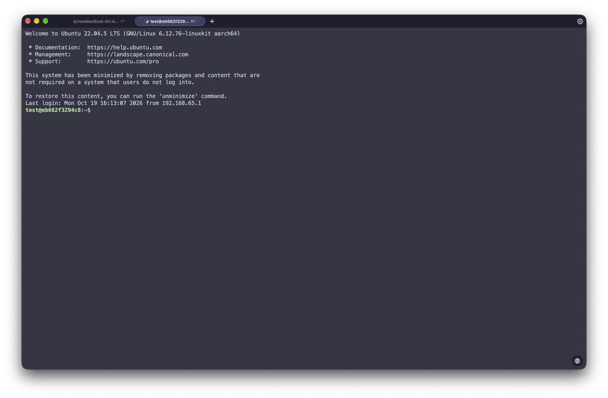
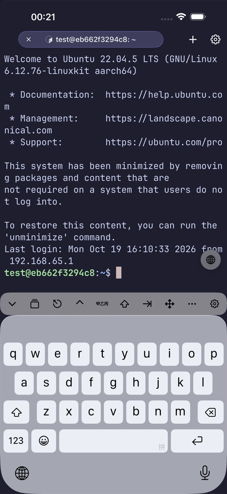
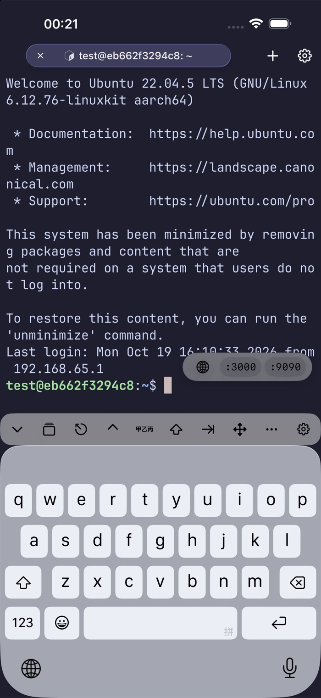
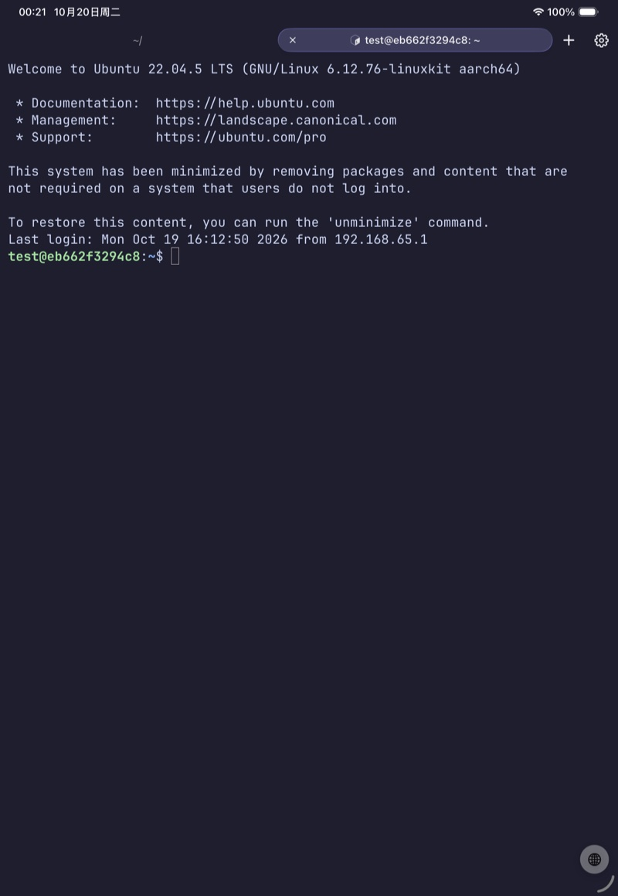
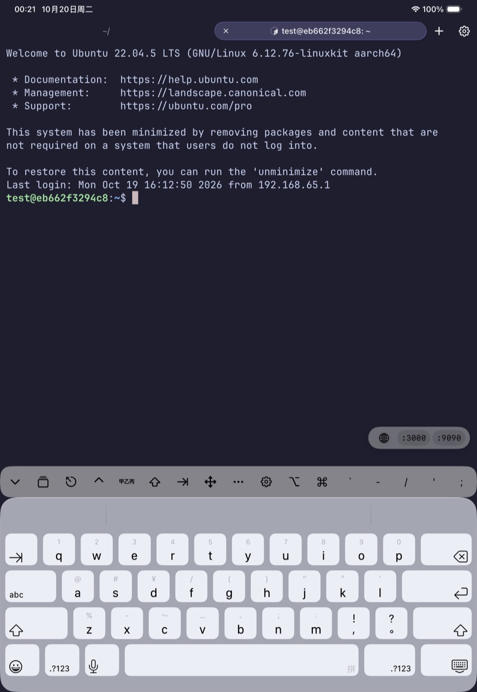

# Remote listening ports

Rootshell can list the TCP ports the connected host listens on and forward a
selected port to a loopback listener on this device. The control lives in the
bottom-right corner of the terminal: a globe while collapsed, and the ports
after a hover (pointer) or tap (touch).

## Behavior

| State | Interaction |
| --- | --- |
| Collapsed | A 39 pt globe at the bottom-right of the terminal column |
| Expanded | Hover the globe, or tap it on a touch device, to show `:3000`, `:9090`, … |
| Mouse leaves | Ports stay for three seconds, then collapse |
| Touch | Ports stay until the globe is tapped again or a port is chosen |
| Port click | Opens a new app tab with an in-app `WKWebView` for the forwarded page |
| Many ports | The row scrolls sideways in a narrow pane; the globe stays put |

The page's text is zoomed against a 16 pt web baseline using the terminal's
effective font size, so a 14 pt terminal and the page read at the same size.

The page tab's address bar is editable: change `http://` to `https://`, edit the
path, or enter another address and press Return. An address without a scheme
opens as `http://`.

A new tab is used instead of an external browser on purpose: the loopback
forward is owned by the app process, and iOS suspends that process when Safari
comes to the foreground.

## Transports

| Connection | Scan | Forward |
| --- | --- | --- |
| SSH (Citadel/NIO) | `ss` / `lsof` / `netstat` over an exec channel | `-L` equivalent through `PortForwardManager` |
| tssh (`trzsz-ssh`) | `TSSHSession.runProbeCommand` | `TrzszPortForwardManager` |
| Mosh / Roam | Over the retained SSH connection that spawned mosh-server | Same SSH connection |
| tmux -CC / herdr pane | Through the gateway pane's connection | Same as the gateway |

Mosh has no exec or forwarding channel of its own, so rootshell keeps the SSH
connection used for `mosh-server` alive for scans and forwards. That connection
does not survive an app relaunch; port forwarding resumes after the next SSH
bootstrap.

## Configuration

Settings → Appearance → Window → **Remote Ports** (`show-remote-ports`). Off by
default: each visible pane polls the host every five seconds while it is on, so
the scan is something you switch on rather than inherit. Turning it off stops
the scan at the next tick and hides the globe.

The scan runs every five seconds while the pane is visible and the app is in the
foreground, and backs off on failure. Only listeners owned by the SSH user are
reported (`ss -p` / `lsof` without root). Servers started by system services,
containers, or other users therefore do not appear.

## Security

- The local listener binds `127.0.0.1` only.
- The local port matches the remote one when nothing on this device already
  listens there; otherwise an ephemeral port is used, so a local server on the
  same port is never shadowed.
- The tunnel dials the address the remote socket listens on (`127.0.0.1`,
  `::1`, `127.0.0.2`, ...); a wildcard IPv6 socket is dialed on `::1`.
- For `https://` on the tab's own forward (`127.0.0.1` and its local port), the
  page tab accepts the server's certificate without validation: development
  servers are usually self-signed, and the SSH tunnel already authenticates the
  host. Every other address and port, and every hostname, is validated normally.
- A forward starts only when the user taps a port; nothing is forwarded
  automatically.
- The page uses a non-persistent `WKWebsiteDataStore`.
- Forwarded pages can still issue requests to other services on the device's
  loopback interface. Treat a forwarded development page like any other
  untrusted local web content.
- Ad-hoc forwards live until the session ends or the user stops them; they are
  not written to the saved port-forward configuration.

## Screenshots

### macOS

Collapsed:

Expanded:

### iPhone

Collapsed:

Expanded:

### iPad

Collapsed:

Expanded:

